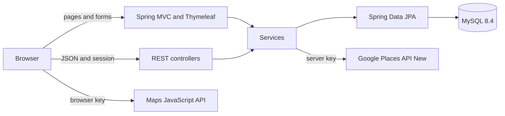

# Architecture

Worth a Stop is a modular Spring Boot application. The server renders Thymeleaf pages; the discovery and place pages enhance those views with JavaScript. REST endpoints are under `/api/v1`.

## Responsibilities

- Controllers bind inputs and choose DTOs, status codes or templates. The same services back MVC and REST.
- The service layer handles input normalization, validation, ownership, visibility, transactions, and bounded result sets. Home uses a bounded sample of local content. Feed queries combine review creation and public collection publication in MySQL and paginate the combined result.
- JPA repositories and MySQL constraints enforce durable relationships. Flyway owns schema changes. Hibernate validates the resulting schema. See [Database design](database-design.md).
- Shared Thymeleaf fragments provide navigation, field errors, profile identities and collection previews. Explore can render a named search directly on the server. JavaScript adds nearby discovery, map selection and asynchronous updates.

## Security and error handling

Spring Security authenticates against BCrypt password hashes and stores the signed-in identity in a server-side session. Forms and JSON mutations require CSRF protection. Public responses use projections that omit credentials and private account fields. Services enforce ownership and hide private collections from nonowners. Database uniqueness protects concurrent and repeated relationship operations.

REST errors use Problem Details for application validation, authorization and access failures. Browsers get inline errors, form feedback or a page-specific error response. Provider errors surface a controlled status and message. Local reviews, relationships and place identities remain stored when Google metadata cannot be refreshed.

## Provider and persistence decisions

Google Places supplies discovery results and metadata while Maps JavaScript renders the map. The server keeps Google IDs and fetches metadata on demand. Legacy OpenStreetMap identities are preserved by the second migration and still show their provenance. The server key stays on the backend. See [Place discovery](place-discovery.md).

The database computes ratings from committed reviews and derives the feed from content and follow relationships. Collection reordering uses a transaction and row lock to preserve a dense order. Review deletion cascades to likes and comments. Deleting a collection removes its memberships and keeps the places.
