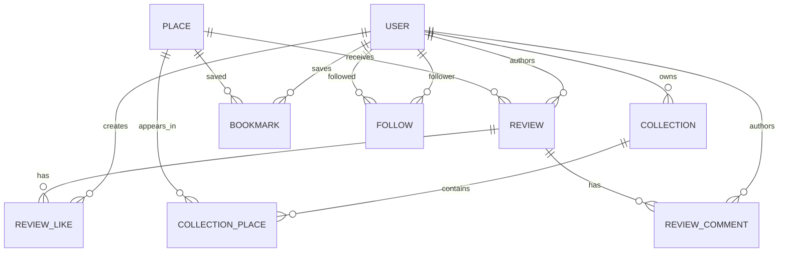

# Database design

The application uses MySQL 8.4 and Flyway migration `V1__initial_schema.sql`. Hibernate validates the schema at startup; it does not create or update tables. The migration is intended for an empty schema and does not automatically baseline a populated database. IDs are generated signed `BIGINT`s. Timestamps are `DATETIME(6)` interpreted as UTC by the JDBC session and Hibernate; review visit dates are `DATE`. Tables use InnoDB and `utf8mb4_0900_ai_ci`.

| Table | Stored data and database constraints |
| --- | --- |
| `users` | Username and email are individually unique under the case-insensitive collation; password hash, display name, biography and timestamps. |
| `places` | Unique OSM type and positive ID; name, category, tag, bounded coordinates, optional address/contact fields, source and metadata timestamps. Type is NODE, WAY or RELATION. |
| `reviews` | Author and place foreign keys, unique author/place pair, rating 1–5, body, optional visit date and timestamps. |
| `review_likes` | Review and user foreign keys, unique review/user pair and creation time. |
| `review_comments` | Review and author foreign keys, body and timestamps. |
| `collections` | Owner, title, description, visibility and timestamps. PUBLIC requires a publication time; PRIVATE requires it to be null. |
| `collection_places` | Collection and place foreign keys; unique place and unique nonnegative position within each collection; added time. |
| `follows` | Follower and followed user foreign keys, unique pair, creation time and a check prohibiting self-follow. |
| `bookmarks` | User and place foreign keys, unique pair and creation time. |

Deleting a review cascades to its likes and comments; deleting a collection cascades to its membership rows. Other relationships restrict deletion. Indexes support the owner, place, time, rating, visibility, ordering and follower access paths in the migration. Review validation and lifecycle rules are enforced by the review service. CollectionService serializes mutations with a collection row lock, enforces the 100-place limit and dense 0-based ordering, and uses temporary positive positions during reorder to avoid transient unique-key collisions.

Accounts use the users table for registration, authentication and profile editing. Place discovery, review and collection workflows are implemented; bookmark and social workflows remain to be implemented.

## Google identity migration

V2__google_place_identity.sql adds nullable `google_place_id VARCHAR(255)` with an ASCII binary collation and a unique constraint. It makes legacy OSM identity/metadata columns nullable. A check permits either the existing OSM identity or a GOOGLE identity with all provider metadata columns null. New Google identities retain only their provider ID, source and application timestamps; metadata is fetched at read time. Existing OSM records and foreign keys from reviews, bookmarks and collection memberships are retained. V1 is unchanged. The Java 21 automated suite applied V1/V2 to isolated MySQL 8.4 databases and validated JPA mappings, the Google metadata constraint, concurrent identity resolution and persistence. These checks do not alter the developer database.
